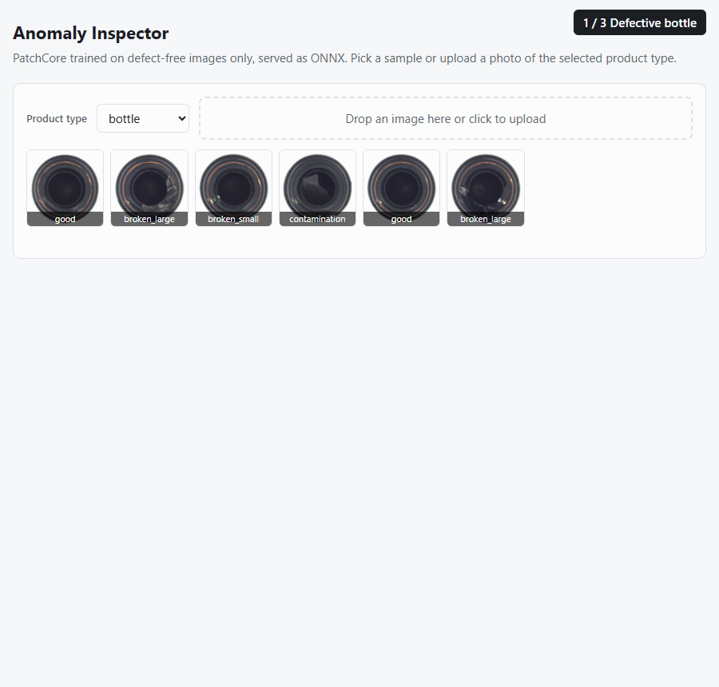
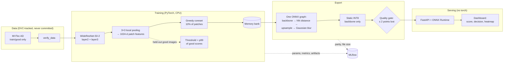
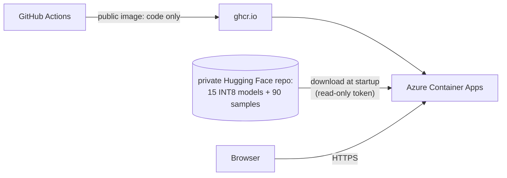

# anomaly_mlops — label-free visual inspection with an MLOps pipeline

[](https://github.com/mohammadbilalhabibi/anomaly_mlops/actions/workflows/ci.yml)

**A visual inspection model that learns only from photos of good parts.** It finds defects it
has never seen and shows where they are with a heatmap. Trained and measured on all 15 product
types of the MVTec AD benchmark, served as an INT8 ONNX model behind FastAPI on a laptop CPU,
with a DVC pipeline, MLflow tracking and GitHub Actions CI, and deployed on Azure.

**[Try the live demo](https://anomaly-inspector.orangebay-5ef51369.francecentral.azurecontainerapps.io)**: pick a
product, click a sample, see the score and heatmap. The app scales to zero when nobody uses it,
so the first visit after a quiet period has to wake it up ([measured below](#deployment)).



<sub>Dashboard demo. Images: MVTec AD, CC BY-NC-SA 4.0 (see [docs/LICENSE.md](docs/LICENSE.md)).</sub>

<!-- HEADLINE:START -->
| Mean over 15 MVTec AD categories | PyTorch (reference) | ONNX INT8 (served) |
|---|---:|---:|
| Image AUROC (finds the defective part) | 98.6% | 98.5% |
| Pixel AUROC (finds the defect pixels) | 97.9% | 97.8% |
| AUPRO (FPR ≤ 0.3, per defect region) | 90.2% | 90.0% |
| Median CPU latency per image, model only | – | 70–259 ms |
| Speed vs ONNX fp32 (median latency) | – | 1.30× faster |
| Model file size vs ONNX fp32 | – | 43% smaller |
| API end-to-end, bottle (median / p95) | – | 214 / 255 ms |

INT8 passes the quality gate (at most 2 points lost on every metric) in 15/15 categories. Latency: laptop CPU, batch size 1.
<!-- HEADLINE:END -->

Why this matters on a production line: defects are rare, new defect types keep appearing, and
labelling defects is expensive. This model only needs a few hundred photos of good parts per
product, which every line already has.

## Findings

- **INT8 is almost free.** The served INT8 model loses 0.1–0.2 points on average against
  PyTorch, while being faster and smaller than ONNX fp32 (headline table).
- **Quantising the wrong layer silently breaks localisation.** My first INT8 model also quantised
  the blur at the end of the graph. Image AUROC stayed the same, but pixel AUROC and AUPRO
  collapsed. A quality gate in the pipeline now checks every metric, not just image AUROC, and
  stops `dvc repro` if INT8 loses more than 2 points.
- **Most of the time goes into the memory-bank search, so the coreset size is the speed knob.**
  With the default 10% coreset, about 78% of the model's compute time is the nearest-neighbour
  search. A 5% coreset is 1.5× faster at the same accuracy. A 1% coreset is 3.4× faster but loses
  1.5 points of AUPRO on average, and 7 points on screw (small defects need a detailed memory).
- **The scores are good; the label-free threshold is the weak part.** A threshold chosen with
  test labels would reach 98% F1 on average, against 92% for the served label-free threshold.
  Ten labelled images (5 good, 5 defective) already raise it to 95%.
- **No single label-free rule can fix it, because the errors go in opposite directions.** For screw
  and pill the threshold is too strict: it misses about 40% of defects, although a threshold with
  at most 5% false alarms would catch about 85%. For wood, leather and carpet it is too loose:
  good test images score higher than the good calibration images, so many good parts are
  flagged. For wood and leather the whole distribution shifts up (statistically significant); for
  carpet mainly the upper tail is wider than in the 28 calibration images. Only capsule really
  overlaps: no threshold catches more than 70% of its defects at 5% false alarms.

## Speed vs accuracy: memory-bank (coreset) size

`python scripts/ablate_coreset.py` retrains bottle, hazelnut, screw and carpet with a 5% and a 1%
coreset (same seed, same calibration split, same INT8 export and benchmark) and compares them
with the 10% default. All numbers are measured and generated from `results/ablation_coreset/`.

<!-- CORESET:START -->
Mean over 4 categories (bottle, carpet, hazelnut, screw), served INT8 model:

| Coreset ratio | Memory bank (mean) | Image AUROC | Pixel AUROC | AUPRO | INT8 median ms | Speed-up vs 10% | NN-search share |
|---|---:|---:|---:|---:|---:|---:|---:|
| 10% | 21,168 | 98.5 | 98.6 | 90.5 | 246 | 1.00× | 78% |
| 5% | 10,584 | 98.9 | 98.5 | 90.5 | 166 | 1.51× | 65% |
| 1% | 2,117 | 98.4 | 98.2 | 89.0 | 72 | 3.41× | 28% |

<details><summary>Per category and ratio</summary>

| Category | Coreset | Memory bank | Image AUROC | Pixel AUROC | AUPRO | Precision | Recall | FPR | INT8 MB | INT8 median / p95 ms | NN-search share |
|---|---:|---:|---:|---:|---:|---:|---:|---:|---:|---:|---:|
| bottle | 10% | 14,740 | 100.0 | 98.2 | 91.8 | 98.4 | 100.0 | 5.0 | 92.2 | 205 / 268 | 71% |
| bottle | 5% | 7,370 | 100.0 | 98.2 | 91.6 | 98.4 | 100.0 | 5.0 | 62.0 | 114 / 129 | 57% |
| bottle | 1% | 1,474 | 100.0 | 98.2 | 91.5 | 95.5 | 100.0 | 15.0 | 37.9 | 67 / 94 | 22% |
| carpet | 10% | 19,757 | 99.0 | 98.8 | 92.0 | 89.8 | 98.9 | 35.7 | 112.8 | 203 / 384 | 79% |
| carpet | 5% | 9,879 | 99.0 | 98.8 | 91.8 | 89.8 | 98.9 | 35.7 | 72.3 | 155 / 204 | 64% |
| carpet | 1% | 1,976 | 99.0 | 98.8 | 91.3 | 89.8 | 98.9 | 35.7 | 39.9 | 68 / 104 | 27% |
| hazelnut | 10% | 27,597 | 100.0 | 98.4 | 86.2 | 100.0 | 100.0 | 0.0 | 145.0 | 321 / 528 | 83% |
| hazelnut | 5% | 13,799 | 100.0 | 98.5 | 86.8 | 100.0 | 100.0 | 0.0 | 88.4 | 208 / 264 | 71% |
| hazelnut | 1% | 2,760 | 100.0 | 98.5 | 88.3 | 100.0 | 98.6 | 0.0 | 43.1 | 83 / 110 | 33% |
| screw | 10% | 22,580 | 95.1 | 98.7 | 92.0 | 98.6 | 57.1 | 2.4 | 124.4 | 255 / 595 | 78% |
| screw | 5% | 11,290 | 96.5 | 98.7 | 91.6 | 98.7 | 63.0 | 2.4 | 78.1 | 185 / 235 | 66% |
| screw | 1% | 2,258 | 94.7 | 97.4 | 85.0 | 97.8 | 73.9 | 4.9 | 41.1 | 69 / 107 | 30% |

</details>

Latency: 11th Gen Intel(R) Core(TM) i7-1165G7 @ 2.80GHz, batch size 1, 50 runs after 5 warm-up runs; all ratios were timed in the same session (the 10% rows reuse the main models and re-time them). Precision, recall and FPR use a threshold recalibrated for each ratio. NN-search share = share of ONNX Runtime kernel time spent comparing patches with the memory bank.
Reproducibility check: 8/8 retrained memory banks are exactly the first rows of the 10% bank (greedy coreset selection is nested).
<!-- CORESET:END -->

**Takeaway:** keep 10% as the default for accuracy-critical parts with small defects (screw),
use 5% wherever latency matters, and 1% only where a 1–2 point AUPRO drop is acceptable.

## Choosing a threshold without defect labels

`python scripts/threshold_study.py` scores the calibration and test images once with the served
INT8 models (per-image scores in `results/threshold_study/scores.csv`) and compares four
label-free rules. Two reference rows use test labels to show what a better threshold could do;
the served model never uses them.

<!-- THRESHOLD:START -->
Mean over 15 categories, served INT8 models (%):

| Threshold rule | Uses defect labels? | Precision | Recall | FPR | F1 |
|---|:---:|---:|---:|---:|---:|
| Served (p99, calibrated in PyTorch) | no | 96.0 | 90.8 | 11.0 | 92.4 |
| p99 | no | 96.6 | 91.6 | 10.8 | 93.2 |
| max | no | 96.7 | 89.6 | 10.2 | 91.8 |
| p95 | no | 93.4 | 95.8 | 19.6 | 94.3 |
| mean + 3·std | no | 97.6 | 89.5 | 7.6 | 92.5 |
| *Reference:* best F1 on 5 good + 5 defective test images (20 splits) | **yes** | 98.4 | 92.8 | 5.8 | 95.4 |
| *Reference:* oracle, best F1 on the full test set | **yes** | 97.9 | 98.1 | 7.1 | 98.0 |

Rows marked *Reference* use test labels and are not used by the served model.

<details><summary>Per category: served threshold, best possible threshold and good-score shift</summary>

| Category | Calib. images | Served recall | Served FPR | Best recall at FPR ≤ 5% (labels) | Oracle F1 (labels) | Few-label F1 (labels) | Good-score median, test / calib. | KS p-value |
|---|---:|---:|---:|---:|---:|---:|---:|---:|
| bottle | 21 | 100.0 | 5.0 | 100.0 | 100.0 | 98.3 ± 1.4 | 0.99× | 0.71 |
| screw | 32 | 57.1 | 2.4 | 87.4 | 94.0 | 90.2 ± 4.3 | 1.03× | 0.23 |
| metal_nut | 22 | 100.0 | 9.1 | 96.8 | 98.9 | 96.8 ± 1.5 | 1.01× | 0.87 |
| cable | 22 | 95.7 | 3.4 | 98.9 | 98.4 | 95.0 ± 3.7 | 0.96× | 0.15 |
| capsule | 22 | 64.2 | 4.3 | 69.7 | 97.2 | 91.3 ± 7.5 | 1.03× | 0.12 |
| carpet | 28 | 98.9 | 35.7 | 94.4 | 97.8 | 95.3 ± 1.9 | 1.03× | 0.056 |
| grid | 26 | 94.7 | 4.8 | 96.5 | 97.3 | 93.8 ± 3.1 | 1.02× | 0.52 |
| hazelnut | 39 | 100.0 | 0.0 | 100.0 | 100.0 | 98.8 ± 1.3 | 0.98× | 0.12 |
| leather | 24 | 100.0 | 15.6 | 100.0 | 100.0 | 98.8 ± 1.6 | 1.10× | 1.1e-06 |
| pill | 27 | 58.9 | 0.0 | 85.1 | 94.6 | 91.8 ± 4.1 | 0.98× | 0.31 |
| tile | 23 | 97.6 | 3.0 | 97.6 | 98.2 | 96.4 ± 3.1 | 0.99× | 0.13 |
| toothbrush | 6 | 96.7 | 25.0 | 93.3 | 96.7 | 95.1 ± 1.6 | 1.00× | 0.96 |
| transistor | 21 | 100.0 | 6.7 | 100.0 | 100.0 | 98.3 ± 1.5 | 1.02× | 0.053 |
| wood | 25 | 100.0 | 47.4 | 95.0 | 97.5 | 95.0 ± 1.2 | 1.12× | 0.0038 |
| zipper | 24 | 97.5 | 3.1 | 99.2 | 99.2 | 95.5 ± 3.8 | 1.03× | 0.36 |

</details>

Recall per defect type at the served threshold (%), lowest first:

| Category | Defect types: recall (n) |
|---|---|
| screw | thread_side 26.1 (23), scratch_head 41.7 (24), manipulated_front 54.2 (24), thread_top 69.6 (23), scratch_neck 92.0 (25) |
| pill | crack 30.8 (26), faulty_imprint 42.1 (19), color 56.0 (25), contamination 66.7 (21), scratch 66.7 (24), combined 82.4 (17), pill_type 100.0 (9) |
| capsule | scratch 43.5 (23), faulty_imprint 45.5 (22), poke 57.1 (21), crack 78.3 (23), squeeze 100.0 (20) |
<!-- THRESHOLD:END -->

**Answer:** for 14 of 15 categories the scores separate well enough: a threshold with at most 5%
false alarms would catch at least 85% of defects. The problem is where the label-free rule puts the
threshold, and it fails in both directions (too strict for screw and pill; too loose for wood,
leather, carpet and toothbrush), so no single rule fixes it: p95 catches more defects but doubles
the false alarms, mean + 3·std does the opposite. The false alarms on wood come from a clear shift
of good scores between calibration and test (KS test p < 0.01); on carpet the median barely moves
but the good test images spread wider than the 28 calibration images (borderline, p ≈ 0.06);
toothbrush has only 6 calibration images. Capsule is the exception: there, good and defective
scores overlap. Most missed defects are small and subtle: screw threads and scratches,
pill cracks and faulty imprints, capsule scratches.

## How it works



**How a prediction works:** the image is resized and centre-cropped (numpy/PIL, the same code in
training and serving). The backbone turns it into a 28×28 grid of patch features. Each patch is
compared with its nearest neighbour in the memory bank of good patches; the distance is its
anomaly score. The grid is upsampled and smoothed into the heatmap, and the image score is the
highest patch score. An image is flagged when that score is above the threshold calibrated on
held-out good images.

## Design decisions and trade-offs

| Decision | Why | Trade-off |
|---|---|---|
| **PatchCore** over autoencoders / PaDiM | Strong localisation without training any network weights; only a forward pass + nearest-neighbour search, which suits a CPU-only laptop | Memory bank grows with the training set; inference cost scales with bank size (measured above) |
| **Label-free threshold** (99th percentile of 10% held-out good images) | Keeps the whole method unsupervised: no defect labels for training *or* thresholding | Few calibration images; too strict or too loose depending on the category (threshold study) |
| **Whole inference in one ONNX graph** (incl. NN search, upsampling, blur) | PyTorch evaluation and ONNX serving compute exactly the same thing; the server is a single `session.run` | The memory bank is baked into the model file (one file per product type) |
| **INT8 on backbone convolutions only**, behind a quality gate | Quantising the distance computation or the blur destroys the small differences that matter (measured) | Smaller gain than full INT8; accuracy change is measured on every run, not assumed |
| **10% coreset default** | Best accuracy on small defects (screw) | 5% would be 1.5× faster at equal mean accuracy (coreset ablation) |
| **MLflow** over Weights & Biases | Runs locally with a sqlite file, no account or API key, and the non-commercial dataset never leaves the machine; can be self-hosted later | Less polished hosted UI and collaboration features |
| **DVC** with one `.dvc` file per category, hardlink cache | Data hashes pin the exact dataset version; `dvc repro` re-runs only what changed; hardlinks avoid a second 5 GB copy | No public DVC remote: the licence forbids redistributing MVTec, so others download it themselves and DVC verifies the hashes |
| **Torch-free serving image** | Preprocessing is pure numpy/PIL and inference is ONNX Runtime, so the container is small and starts fast | Two dependency sets to keep consistent (tested in CI) |
| **Static HTML dashboard served by FastAPI** | One process, one port, no frontend build | Basic UI compared with Streamlit/Gradio |

## MLOps

- **Pipeline (`dvc.yaml`):** `verify_data → train → export → evaluate → benchmark`, one stage
  instance per category. Parameters live in `params.yaml`; `dvc repro` re-runs only stages whose
  code, data or parameters changed, and `dvc.lock` records the hashes of every input and output.
- **Quality gate:** the `evaluate` stage fails if an ONNX variant loses more than
  `max_metric_drop` (2 points) against PyTorch on image AUROC, pixel AUROC or AUPRO.
- **Data versioning:** each MVTec category is a DVC-tracked directory (`data/mvtec_ad/<category>.dvc`).
- **Experiment tracking:** every training run logs parameters, git commit, timings, memory-bank
  size and threshold to MLflow; evaluation and export add their metrics to the same run, plus
  example heatmaps. The coreset ablation logs to its own experiment, `coreset_ablation`.
- **Experiments outside the main pipeline:** the coreset ablation and the threshold study are one
  command each and write to their own `results/` folders, so they never change the main results.
- **CI (`.github/workflows/ci.yml`):** ruff lint + format check, pytest on synthetic images with a
  tiny random backbone (no dataset or weight downloads), Docker build with a `/api/health` smoke
  test and checks that the serving image contains no torch and no models or dataset images. On
  pushes to `main` the image is published to `ghcr.io/mohammadbilalhabibi/anomaly_mlops`.

## Deployment

The [live demo](https://anomaly-inspector.orangebay-5ef51369.francecentral.azurecontainerapps.io)
runs on **Azure Container Apps** (Consumption plan, 1.5 vCPU / 3 GiB, scale 0–1 replicas).



- **No dataset-derived files in public.** Models trained on MVTec AD and its images are
  CC BY-NC-SA. The Docker image contains only code (CI checks this), so it can be public. The
  models and sample images sit in a private Hugging Face repo, and the app downloads them once at
  startup with a read-only token stored as an Azure secret.
- **Scale to zero.** No traffic means no replica and almost no cost. The price is a cold start
  for the first visitor. A $10/month budget alert covers the resource group.
- **Deploy:** `python scripts/upload_assets_hf.py --repo <user>/anomaly-mlops-assets` (once, and
  after retraining), put `HF_TOKEN=<read-only token>` in `.env`, then
  `powershell -ExecutionPolicy Bypass -File scripts\deploy_azure.ps1` after `az login`.

<!-- DEPLOY:START -->
| Live app (bottle, ONNX int8, 50 requests) | median | p95 |
|---|---:|---:|
| Model only (on the server) | 128 ms | – |
| Server total: decode, model, heatmap PNGs | 192 ms | 197 ms |
| Round trip from a laptop in Deggendorf (incl. upload) | 407 ms | 509 ms |

First request after the app has scaled to zero: **22 s** (start a replica, pull the image, download 1.5 GB of models and samples, load 15 models). Every request after that is fast.
<!-- DEPLOY:END -->

Measured with `scripts/benchmark_api.py --url <app url> --out latency_azure.json --cold-start`.
The round trip includes uploading a 0.5 MB PNG over a home connection, so it depends on the
visitor's network; the server times do not.

## Run locally

Windows PowerShell, Python 3.12. First download MVTec AD (see [Dataset and licence](#dataset-and-licence))
and extract it so that `data/mvtec_ad/bottle/train/good/000.png` exists.

```powershell
git clone https://github.com/mohammadbilalhabibi/anomaly_mlops; cd anomaly_mlops
python -m venv .venv; .venv\Scripts\Activate.ps1
pip install -e ".[ml,mlops,dev]"
dvc repro
uvicorn anomaly.serve.api:app --port 8000
```

Then open <http://127.0.0.1:8000>. `dvc repro` trains, exports, evaluates and benchmarks the
categories listed in `params.yaml`; `python scripts/make_results_table.py` refreshes all tables in
this README. Tests and lint: `pytest` and `ruff check .`.

Pipeline run time on the laptop CPU (from the pipeline logs): 25 min for bottle, screw and
metal_nut, 87 min for the other 12 categories. For a quick run, list fewer categories in
`params.yaml`. If DVC reports a category's data as changed, your download differs from the
version used here (`dvc add data/mvtec_ad/<category>` records it). Browse experiments with
`mlflow ui --backend-store-uri sqlite:///mlflow.db`.

Experiments and demo (after `dvc repro`):

```powershell
python scripts/ablate_coreset.py        # about 25 min on the laptop CPU
python scripts/threshold_study.py       # a few minutes; --reuse re-analyses the saved scores
pip install -e ".[demo]"; python scripts/record_demo.py   # API must be running; uses Edge
```

Docker (serving only; models are mounted, not baked in):

```powershell
docker build -t anomaly-mlops .
docker run -p 8000:8000 -v ${PWD}/models:/app/models anomaly-mlops
```

### API

| Endpoint | Description |
|---|---|
| `GET /api/health` | Status, served variant, loaded categories |
| `GET /api/categories` | Categories with calibrated thresholds |
| `GET /api/samples` | Sample test images found on the server |
| `POST /api/predict` | Form fields `category`, `file` → score, threshold, decision, latency, base64 PNG crop / overlay / heatmap |

Settings come from environment variables or `.env` (see `.env.example`): `MODELS_DIR`,
`MODEL_VARIANT` (`int8`, the default, or `fp32`), `SAMPLES_DIR`, `ORT_THREADS`, and for the
deployment `HF_ASSETS_REPO` (download models and samples from that private repo at startup; the
token comes from `HF_TOKEN`).

## Full results per category

All numbers are generated by `scripts/make_results_table.py` from the JSON files the pipeline
writes to `results/`; none are typed by hand. Pixel metrics are computed on the 224×224 centre
crop the model sees (the PatchCore paper's protocol: resize 256, crop 224).

<details><summary>Detection, localisation, decisions, latency and ONNX export for all 15 categories</summary>

<!-- RESULTS:START -->
### Detection and localisation (MVTec AD test set, %)

| Category | Image AUROC | Pixel AUROC | AUPRO (FPR≤0.3) | INT8 Image AUROC | INT8 Pixel AUROC | INT8 AUPRO | INT8 gate |
|---|---:|---:|---:|---:|---:|---:|:---:|
| bottle | 100.0 | 98.3 | 92.5 | 100.0 | 98.2 | 91.8 | pass |
| cable | 99.6 | 98.6 | 93.3 | 99.6 | 98.5 | 93.2 | pass |
| capsule | 95.8 | 98.7 | 91.1 | 95.3 | 98.6 | 90.3 | pass |
| carpet | 99.1 | 98.8 | 91.9 | 99.0 | 98.8 | 92.0 | pass |
| grid | 98.4 | 97.7 | 89.4 | 98.4 | 97.6 | 89.0 | pass |
| hazelnut | 100.0 | 98.4 | 86.3 | 100.0 | 98.4 | 86.2 | pass |
| leather | 100.0 | 99.0 | 95.8 | 100.0 | 99.1 | 95.7 | pass |
| metal_nut | 99.7 | 98.5 | 91.5 | 99.7 | 98.5 | 91.3 | pass |
| pill | 94.2 | 97.6 | 91.3 | 94.4 | 97.6 | 91.2 | pass |
| screw | 95.2 | 98.8 | 93.0 | 95.1 | 98.7 | 92.0 | pass |
| tile | 98.4 | 95.3 | 78.8 | 98.4 | 95.5 | 79.2 | pass |
| toothbrush | 99.2 | 98.7 | 87.2 | 98.9 | 98.6 | 86.9 | pass |
| transistor | 100.0 | 97.5 | 94.8 | 100.0 | 97.5 | 94.7 | pass |
| wood | 99.3 | 93.7 | 83.5 | 99.1 | 93.9 | 83.5 | pass |
| zipper | 99.5 | 98.3 | 92.8 | 99.4 | 98.3 | 92.8 | pass |
| **mean (15)** | **98.6** | **97.9** | **90.2** | **98.5** | **97.8** | **90.0** | |

PyTorch columns = reference model. ONNX fp32 differs from it by at most 3e-05 points on any metric across 15 categories. INT8 gate: every metric within the `max_metric_drop` set in `params.yaml`.

### Decisions at the label-free threshold (%)

| Category | Test images (defect) | Precision | Recall | False-positive rate |
|---|---:|---:|---:|---:|
| bottle | 83 (63) | 98.4 | 100.0 | 5.0 |
| cable | 150 (92) | 98.9 | 94.6 | 1.7 |
| capsule | 132 (109) | 98.6 | 62.4 | 4.3 |
| carpet | 117 (89) | 90.7 | 98.9 | 32.1 |
| grid | 78 (57) | 98.2 | 94.7 | 4.8 |
| hazelnut | 110 (70) | 100.0 | 100.0 | 0.0 |
| leather | 124 (92) | 94.8 | 100.0 | 15.6 |
| metal_nut | 115 (93) | 97.9 | 100.0 | 9.1 |
| pill | 167 (141) | 100.0 | 57.4 | 0.0 |
| screw | 160 (119) | 98.5 | 53.8 | 2.4 |
| tile | 117 (84) | 98.8 | 97.6 | 3.0 |
| toothbrush | 42 (30) | 93.5 | 96.7 | 16.7 |
| transistor | 100 (40) | 93.0 | 100.0 | 5.0 |
| wood | 79 (60) | 87.0 | 100.0 | 47.4 |
| zipper | 151 (119) | 99.1 | 97.5 | 3.1 |

### CPU latency per image

Measured on 11th Gen Intel(R) Core(TM) i7-1165G7 @ 2.80GHz (8 logical cores, no GPU), batch size 1, 50 runs after 5 warm-up runs, torch 2.15.0+cpu, onnxruntime 1.32.0. Times in ms per image (median / p95).

| Category | Memory bank | Preprocess | PyTorch fp32 | ONNX fp32 | ONNX INT8 |
|---|---:|---:|---:|---:|---:|
| bottle | 14,740 | 18.8 / 21.0 | 258.4 / 293.2 | 212.5 / 246.4 | 166.1 / 236.6 |
| cable | 15,837 | 34.5 / 41.7 | 266.5 / 294.6 | 208.9 / 251.9 | 157.5 / 188.8 |
| capsule | 15,445 | 31.9 / 37.9 | 265.9 / 296.4 | 230.7 / 285.4 | 155.2 / 184.9 |
| carpet | 19,757 | 30.7 / 37.1 | 298.1 / 316.2 | 241.4 / 290.6 | 187.6 / 219.4 |
| grid | 18,660 | 16.2 / 19.1 | 315.7 / 397.7 | 229.0 / 277.5 | 184.1 / 207.5 |
| hazelnut | 27,597 | 30.3 / 34.4 | 373.8 / 457.1 | 299.3 / 395.3 | 259.3 / 331.5 |
| leather | 17,327 | 29.8 / 33.7 | 294.5 / 325.0 | 232.5 / 303.0 | 168.8 / 187.6 |
| metal_nut | 15,524 | 14.8 / 18.3 | 278.3 / 312.9 | 207.9 / 247.5 | 182.0 / 219.2 |
| pill | 18,816 | 19.2 / 21.9 | 299.2 / 347.7 | 227.9 / 282.3 | 208.5 / 245.1 |
| screw | 22,580 | 16.3 / 20.2 | 382.8 / 575.4 | 257.5 / 307.4 | 207.8 / 230.1 |
| tile | 16,229 | 23.1 / 27.1 | 279.5 / 308.2 | 220.1 / 290.9 | 158.9 / 182.0 |
| toothbrush | 4,234 | 30.0 / 34.2 | 167.2 / 194.1 | 111.5 / 151.3 | 70.1 / 81.7 |
| transistor | 15,053 | 36.9 / 41.0 | 264.8 / 307.4 | 202.8 / 256.0 | 151.0 / 177.7 |
| wood | 17,405 | 39.0 / 43.8 | 298.7 / 322.7 | 216.9 / 267.4 | 172.9 / 198.3 |
| zipper | 16,935 | 14.8 / 17.5 | 275.1 / 311.9 | 216.1 / 260.3 | 171.6 / 219.3 |

End-to-end HTTP `POST /api/predict` (bottle, ONNX int8, 50 requests on localhost, incl. upload, decode, heatmap PNG encoding): median 214.2 ms, p95 255.2 ms.

### ONNX export

| Category | ONNX fp32 MB | ONNX INT8 MB | fp32 max rel. score diff | INT8 max rel. score diff |
|---|---:|---:|---:|---:|
| bottle | 166.4 | 92.2 | 2.6e-06 | 8.1e-02 |
| cable | 170.9 | 96.7 | 1.6e-06 | 4.0e-02 |
| capsule | 169.3 | 95.1 | 1.0e-05 | 2.0e-01 |
| carpet | 187.0 | 112.8 | 4.6e-06 | 4.0e-02 |
| grid | 182.5 | 108.3 | 6.5e-06 | 9.7e-03 |
| hazelnut | 219.1 | 145.0 | 2.1e-06 | 8.2e-02 |
| leather | 177.0 | 102.9 | 4.0e-06 | 2.5e-02 |
| metal_nut | 169.6 | 95.5 | 1.3e-06 | 1.5e-02 |
| pill | 183.1 | 109.0 | 2.5e-06 | 2.4e-02 |
| screw | 198.5 | 124.4 | 5.8e-06 | 4.3e-02 |
| tile | 172.5 | 98.4 | 1.4e-06 | 3.0e-02 |
| toothbrush | 123.3 | 49.2 | 3.5e-06 | 4.7e-02 |
| transistor | 167.7 | 93.5 | 2.8e-06 | 2.6e-02 |
| wood | 177.3 | 103.2 | 1.3e-06 | 6.5e-02 |
| zipper | 175.4 | 101.2 | 5.0e-06 | 2.9e-02 |

### What INT8 quantization should not touch

Pixel AUROC / AUPRO (%) on the test set for three ONNX variants:

| Category | fp32 | INT8, blur convs also quantized | INT8, backbone only (served) |
|---|---:|---:|---:|
| bottle | 98.3 / 92.5 | 77.0 / 32.6 | 98.2 / 91.8 |
| metal_nut | 98.5 / 91.5 | 82.8 / 43.6 | 98.5 / 91.3 |
| screw | 98.8 / 93.0 | 85.5 / 51.3 | 98.7 / 92.0 |
<!-- RESULTS:END -->

</details>

## Limitations

- **CPU only.** Everything was trained and measured on a 4-core laptop CPU without a GPU. Latency
  numbers apply to that machine and vary between sessions (the coreset ablation times all
  ratios in one session for that reason).
- **One run, paper defaults.** All 15 categories were run once with a fixed seed; no variance over
  seeds is reported. Hyperparameters are the PatchCore paper's defaults and nothing was tuned on
  the test set. Mean image AUROC is somewhat below the published PatchCore numbers; likely reasons
  are the missing score re-weighting and the simpler channel projection used here.
- **Resolution:** 224×224 centre crop. Defects at the very edge of the original image can be cut
  off, and small defects (screw threads, pill cracks) lose detail. These are the defect types
  missed most often.
- **Threshold:** calibrated on 10% of the good training images (6 for toothbrush, up to 39 for
  hazelnut). The threshold study shows this is the weakest part of the system.
- **Coreset ablation:** 4 of 15 categories, chosen for the largest memory banks plus bottle.
- **Benchmark vs. production:** MVTec AD images are well lit and aligned. A real line would need
  its own good-part images, monitoring of score drift, and periodic re-fitting of the memory bank.
- **Licence:** models trained on MVTec AD are for non-commercial use and are not published; the
  live demo downloads them from a private repo and serves them only through the dashboard.
- **Live demo:** one replica of 1.5 vCPU, so concurrent visitors queue, and a cold start after
  idle (see [Deployment](#deployment)).

## What I would do next

- **Set thresholds with a few labels.** Ten labelled images per product already lift F1 from 92%
  to 95% in the threshold study; a target false-alarm rate per station would make that a clear rule.
- **Make the search cheaper.** Ship a 5% coreset where latency matters, or replace the exact
  nearest-neighbour search with an approximate index (e.g. FAISS) to keep a large bank fast.
- **Higher resolution for small defects.** Tiles or a larger input for screw, pill and capsule,
  where small cracks, scratches and thread defects are missed most.

## Project layout

```
src/anomaly/          preprocess, data, model (PatchCore modules), coreset, patchcore (fit/save/load),
                      metrics, export (ONNX/INT8), onnx_infer, heatmap, tracking (MLflow),
                      bench (latency), profiling (ONNX Runtime stage split), thresholds
src/anomaly/serve/    FastAPI app + static dashboard
scripts/              pipeline: verify_data, train, export_onnx, evaluate, benchmark
                      experiments: ablate_coreset, threshold_study
                      tools: benchmark_api, make_results_table, record_demo
params.yaml dvc.yaml  pipeline definition and parameters
results/              measured metrics (JSON/CSV, committed)
docs/                 demo GIF and screenshot (MVTec images, CC BY-NC-SA 4.0)
tests/                pytest (synthetic data)
```

## Dataset and licence

[MVTec AD](https://www.mvtec.com/company/research/datasets/mvtec-ad): Bergmann et al.,
"MVTec AD — A Comprehensive Real-World Dataset for Unsupervised Anomaly Detection", CVPR 2019.
It is licensed under **CC BY-NC-SA 4.0** (non-commercial). Download it from MVTec's website after
accepting their terms. The dataset and models trained on it are not in this repository; the only
MVTec images here are the demo media in `docs/`, shared under the same licence
([docs/LICENSE.md](docs/LICENSE.md)).

Method: Roth et al., "Towards Total Recall in Industrial Anomaly Detection", CVPR 2022.
Backbone weights: torchvision `Wide_ResNet50_2_Weights.IMAGENET1K_V1`.
