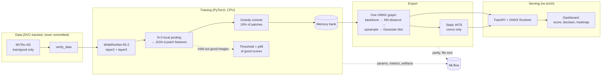

# anomaly_mlops — label-free visual inspection with an MLOps pipeline

**Finds and localises defects on industrial parts without ever seeing a defect during training.**
PatchCore learns what *good* bottles, screws and metal nuts look like from defect-free
images only, then flags anything that deviates and draws a heatmap of where. The model is
exported to a single ONNX graph, quantised to INT8, served by FastAPI on CPU, and the whole
path from raw data to served model is versioned with DVC and tracked with MLflow.

Why this matters on a production line: defects are rare, new defect types keep appearing,
and labelling pixel masks is expensive. An unsupervised detector only needs a few hundred
photos of good parts per product, which every line already produces.

| | |
|---|---|
| **Method** | PatchCore (Roth et al., CVPR 2022), WideResNet-50-2 features, greedy coreset, 1-NN scoring |
| **Data** | MVTec AD (industrial anomaly benchmark), trained on `train/good` only |
| **Metrics** | Image AUROC, pixel AUROC, AUPRO (FPR ≤ 0.3), measured per category |
| **MLOps** | DVC pipeline + data versioning, MLflow tracking, GitHub Actions CI (ruff, pytest, Docker) |
| **Serving** | ONNX Runtime (fp32 / static INT8), FastAPI, web dashboard, torch-free Docker image |

## Results

All numbers below are generated by `scripts/make_results_table.py` from the JSON files that
the pipeline writes to `results/` — none are typed by hand. Pixel metrics are computed on the
224×224 centre crop the model sees (the PatchCore paper's protocol: resize 256, crop 224).

<!-- RESULTS:START -->
**Headline (15 categories):** mean image AUROC 98.6%, pixel AUROC 97.9%, AUPRO 90.2%. The served INT8 ONNX model keeps image AUROC 98.5% / AUPRO 90.0% and passes the quality gate in 15/15 categories. INT8 inference takes 70–259 ms median per image on a laptop CPU, depending on memory-bank size.

### Detection and localisation (MVTec AD test set, %)

| Category | Image AUROC | Pixel AUROC | AUPRO (FPR≤0.3) | INT8 Image AUROC | INT8 Pixel AUROC | INT8 AUPRO | INT8 gate |
|---|---:|---:|---:|---:|---:|---:|:---:|
| bottle | 100.0 | 98.3 | 92.5 | 100.0 | 98.2 | 91.8 | pass |
| cable | 99.6 | 98.6 | 93.3 | 99.6 | 98.5 | 93.2 | pass |
| capsule | 95.8 | 98.7 | 91.1 | 95.3 | 98.6 | 90.3 | pass |
| carpet | 99.1 | 98.8 | 91.9 | 99.0 | 98.8 | 92.0 | pass |
| grid | 98.4 | 97.7 | 89.4 | 98.4 | 97.6 | 89.0 | pass |
| hazelnut | 100.0 | 98.4 | 86.3 | 100.0 | 98.4 | 86.2 | pass |
| leather | 100.0 | 99.0 | 95.8 | 100.0 | 99.1 | 95.7 | pass |
| metal_nut | 99.7 | 98.5 | 91.5 | 99.7 | 98.5 | 91.3 | pass |
| pill | 94.2 | 97.6 | 91.3 | 94.4 | 97.6 | 91.2 | pass |
| screw | 95.2 | 98.8 | 93.0 | 95.1 | 98.7 | 92.0 | pass |
| tile | 98.4 | 95.3 | 78.8 | 98.4 | 95.5 | 79.2 | pass |
| toothbrush | 99.2 | 98.7 | 87.2 | 98.9 | 98.6 | 86.9 | pass |
| transistor | 100.0 | 97.5 | 94.8 | 100.0 | 97.5 | 94.7 | pass |
| wood | 99.3 | 93.7 | 83.5 | 99.1 | 93.9 | 83.5 | pass |
| zipper | 99.5 | 98.3 | 92.8 | 99.4 | 98.3 | 92.8 | pass |
| **mean (15)** | **98.6** | **97.9** | **90.2** | **98.5** | **97.8** | **90.0** | |

PyTorch columns = reference model. ONNX fp32 differs from it by at most 3e-05 points on any metric across 15 categories. INT8 gate: every metric within the `max_metric_drop` set in `params.yaml`.

### Decisions at the label-free threshold (%)

| Category | Test images (defect) | Precision | Recall | False-positive rate |
|---|---:|---:|---:|---:|
| bottle | 83 (63) | 98.4 | 100.0 | 5.0 |
| cable | 150 (92) | 98.9 | 94.6 | 1.7 |
| capsule | 132 (109) | 98.6 | 62.4 | 4.3 |
| carpet | 117 (89) | 90.7 | 98.9 | 32.1 |
| grid | 78 (57) | 98.2 | 94.7 | 4.8 |
| hazelnut | 110 (70) | 100.0 | 100.0 | 0.0 |
| leather | 124 (92) | 94.8 | 100.0 | 15.6 |
| metal_nut | 115 (93) | 97.9 | 100.0 | 9.1 |
| pill | 167 (141) | 100.0 | 57.4 | 0.0 |
| screw | 160 (119) | 98.5 | 53.8 | 2.4 |
| tile | 117 (84) | 98.8 | 97.6 | 3.0 |
| toothbrush | 42 (30) | 93.5 | 96.7 | 16.7 |
| transistor | 100 (40) | 93.0 | 100.0 | 5.0 |
| wood | 79 (60) | 87.0 | 100.0 | 47.4 |
| zipper | 151 (119) | 99.1 | 97.5 | 3.1 |

### CPU latency per image

Measured on 11th Gen Intel(R) Core(TM) i7-1165G7 @ 2.80GHz (8 logical cores, no GPU), batch size 1, 50 runs after 5 warm-up runs, torch 2.15.0+cpu, onnxruntime 1.32.0. Times in ms per image (median / p95).

| Category | Memory bank | Preprocess | PyTorch fp32 | ONNX fp32 | ONNX INT8 |
|---|---:|---:|---:|---:|---:|
| bottle | 14,740 | 18.8 / 21.0 | 258.4 / 293.2 | 212.5 / 246.4 | 166.1 / 236.6 |
| cable | 15,837 | 34.5 / 41.7 | 266.5 / 294.6 | 208.9 / 251.9 | 157.5 / 188.8 |
| capsule | 15,445 | 31.9 / 37.9 | 265.9 / 296.4 | 230.7 / 285.4 | 155.2 / 184.9 |
| carpet | 19,757 | 30.7 / 37.1 | 298.1 / 316.2 | 241.4 / 290.6 | 187.6 / 219.4 |
| grid | 18,660 | 16.2 / 19.1 | 315.7 / 397.7 | 229.0 / 277.5 | 184.1 / 207.5 |
| hazelnut | 27,597 | 30.3 / 34.4 | 373.8 / 457.1 | 299.3 / 395.3 | 259.3 / 331.5 |
| leather | 17,327 | 29.8 / 33.7 | 294.5 / 325.0 | 232.5 / 303.0 | 168.8 / 187.6 |
| metal_nut | 15,524 | 14.8 / 18.3 | 278.3 / 312.9 | 207.9 / 247.5 | 182.0 / 219.2 |
| pill | 18,816 | 19.2 / 21.9 | 299.2 / 347.7 | 227.9 / 282.3 | 208.5 / 245.1 |
| screw | 22,580 | 16.3 / 20.2 | 382.8 / 575.4 | 257.5 / 307.4 | 207.8 / 230.1 |
| tile | 16,229 | 23.1 / 27.1 | 279.5 / 308.2 | 220.1 / 290.9 | 158.9 / 182.0 |
| toothbrush | 4,234 | 30.0 / 34.2 | 167.2 / 194.1 | 111.5 / 151.3 | 70.1 / 81.7 |
| transistor | 15,053 | 36.9 / 41.0 | 264.8 / 307.4 | 202.8 / 256.0 | 151.0 / 177.7 |
| wood | 17,405 | 39.0 / 43.8 | 298.7 / 322.7 | 216.9 / 267.4 | 172.9 / 198.3 |
| zipper | 16,935 | 14.8 / 17.5 | 275.1 / 311.9 | 216.1 / 260.3 | 171.6 / 219.3 |

End-to-end HTTP `POST /api/predict` (bottle, ONNX int8, 50 requests on localhost, incl. upload, decode, heatmap PNG encoding): median 214.2 ms, p95 255.2 ms.

### ONNX export

| Category | ONNX fp32 MB | ONNX INT8 MB | fp32 max rel. score diff | INT8 max rel. score diff |
|---|---:|---:|---:|---:|
| bottle | 166.4 | 92.2 | 2.6e-06 | 8.1e-02 |
| cable | 170.9 | 96.7 | 1.6e-06 | 4.0e-02 |
| capsule | 169.3 | 95.1 | 1.0e-05 | 2.0e-01 |
| carpet | 187.0 | 112.8 | 4.6e-06 | 4.0e-02 |
| grid | 182.5 | 108.3 | 6.5e-06 | 9.7e-03 |
| hazelnut | 219.1 | 145.0 | 2.1e-06 | 8.2e-02 |
| leather | 177.0 | 102.9 | 4.0e-06 | 2.5e-02 |
| metal_nut | 169.6 | 95.5 | 1.3e-06 | 1.5e-02 |
| pill | 183.1 | 109.0 | 2.5e-06 | 2.4e-02 |
| screw | 198.5 | 124.4 | 5.8e-06 | 4.3e-02 |
| tile | 172.5 | 98.4 | 1.4e-06 | 3.0e-02 |
| toothbrush | 123.3 | 49.2 | 3.5e-06 | 4.7e-02 |
| transistor | 167.7 | 93.5 | 2.8e-06 | 2.6e-02 |
| wood | 177.3 | 103.2 | 1.3e-06 | 6.5e-02 |
| zipper | 175.4 | 101.2 | 5.0e-06 | 2.9e-02 |

### What INT8 quantization should not touch

Pixel AUROC / AUPRO (%) on the test set for three ONNX variants:

| Category | fp32 | INT8, blur convs also quantized | INT8, backbone only (served) |
|---|---:|---:|---:|
| bottle | 98.3 / 92.5 | 77.0 / 32.6 | 98.2 / 91.8 |
| metal_nut | 98.5 / 91.5 | 82.8 / 43.6 | 98.5 / 91.3 |
| screw | 98.8 / 93.0 | 85.5 / 51.3 | 98.7 / 92.0 |
<!-- RESULTS:END -->

## Findings

- **ONNX fp32 is a drop-in replacement for PyTorch.** Exporting the *whole* inference path
  (not just the backbone) gives identical metrics and image-score differences around 1e-6,
  while running faster on CPU (see the latency table).
- **Quantising the wrong layer silently destroys localisation.** The first INT8 export quantised
  every `Conv`, including the two Gaussian-blur convolutions at the end of the graph. Image AUROC
  barely moved, but the anomaly map was rounded to 256 levels and pixel AUROC / AUPRO collapsed
  (table "What INT8 quantization should not touch"; the results of that run are kept in
  `results/ablation_int8_blur_quantized/`). Restricting INT8 to the backbone recovered
  localisation to within about one point of fp32. A unit test now checks that no node after the
  backbone is quantised.
- **Image-level AUROC alone is a misleading acceptance test** for an inspection model: the broken
  INT8 model above would have passed it. The `evaluate` stage therefore runs a quality gate:
  an ONNX variant may lose at most `max_metric_drop` (2 points) against PyTorch on image AUROC,
  pixel AUROC *and* AUPRO, otherwise the stage fails and `dvc repro` stops.
- **Nearest-neighbour search, not the backbone, dominates latency for large memory banks.**
  Every category uses the same backbone, yet INT8 latency grows with memory-bank size from
  toothbrush (smallest bank) to hazelnut (largest). The coreset ratio is therefore the main
  speed/accuracy knob; a 1% coreset or an approximate NN index (e.g. FAISS) would be the next step.
- **AUROC is high, but a label-free operating point is the hard part.** With the threshold set at
  the 99th percentile of 6–39 held-out good images, some categories miss many defects (screw,
  pill and capsule recall well below 70%) while textured surfaces with more varied good samples
  raise many false alarms (wood, carpet). On a real line the threshold would be set against a
  target false-alarm rate with a small labelled validation set, or tuned per station.

## Architecture



**How a prediction works:** the image is resized and centre-cropped (numpy/PIL, the same
code in training and serving), the backbone produces a 28×28 grid of patch features, each
patch's distance to its nearest neighbour in the memory bank becomes its anomaly score, the
grid is upsampled and smoothed into a heatmap, and the image score is the highest patch score.
An image is flagged when its score exceeds the threshold calibrated on held-out good images.

## Design decisions and trade-offs

| Decision | Why | Trade-off |
|---|---|---|
| **PatchCore** over autoencoders / PaDiM | Strong localisation without training any network weights; only a forward pass + nearest-neighbour search, which suits a CPU-only laptop | Memory bank grows with the training set; inference cost scales with bank size |
| **Label-free threshold** (99th percentile of 10% held-out good images) | Keeps the whole method unsupervised — no defect labels for training *or* thresholding | Fewer images in the memory bank; the threshold can be conservative or loose depending on how varied good parts are |
| **Whole inference in one ONNX graph** (incl. NN search, upsampling, blur) | PyTorch evaluation and ONNX serving compute exactly the same thing; the server is a single `session.run` | The memory bank is baked into the model file (one file per product type) |
| **INT8 on convolutions only** | The backbone dominates compute; quantising the distance MatMul would destroy the small differences that separate good from defective patches | Smaller gain than full INT8; accuracy change is measured, not assumed |
| **MLflow** over Weights & Biases | Runs locally with a sqlite file, no account or API key, and the non-commercial dataset never leaves the machine; can be self-hosted later | Less polished hosted UI and collaboration features |
| **DVC** with one `.dvc` file per category, hardlink cache | Data hashes pin the exact dataset version; `dvc repro` re-runs only what changed; hardlinks avoid a second 5 GB copy | No public DVC remote: the licence forbids redistributing MVTec, so others download it themselves and DVC verifies the hashes |
| **Torch-free serving image** | Preprocessing is pure numpy/PIL and inference is ONNX Runtime, so the container is small and starts fast | Two dependency sets to keep consistent (tested in CI) |
| **Static HTML dashboard served by FastAPI** | One process, one port, no frontend build | Basic UI compared with Streamlit/Gradio |

## MLOps

- **Pipeline (`dvc.yaml`):** `verify_data → train → export → evaluate → benchmark`, one stage
  instance per category. Parameters live in `params.yaml`; `dvc repro` re-runs only stages whose
  code, data or parameters changed, and `dvc.lock` records the hashes of every input and output.
- **Data versioning:** each MVTec category is a DVC-tracked directory (`data/mvtec_ad/<category>.dvc`).
- **Experiment tracking:** every training run logs parameters, git commit, timings, memory-bank
  size and threshold to MLflow; evaluation and export add their metrics to the same run, plus
  example heatmaps. `mlflow ui --backend-store-uri sqlite:///mlflow.db` to browse.
- **CI (`.github/workflows/ci.yml`):** ruff lint + format check, pytest on synthetic images with a
  tiny random backbone (no dataset or weight downloads), Docker build with a `/api/health` smoke
  test and a check that the serving image contains no torch.

## Run locally

Windows PowerShell, Python 3.12. First download MVTec AD (see [Dataset and licence](#dataset-and-licence))
and extract it so that `data/mvtec_ad/bottle/train/good/000.png` exists.

```powershell
git clone https://github.com/mohammadbilalhabibi/anomaly_mlops; cd anomaly_mlops
python -m venv .venv; .venv\Scripts\Activate.ps1
pip install -e ".[ml,mlops,dev]"
dvc repro
uvicorn anomaly.serve.api:app --port 8000
```

Then open <http://127.0.0.1:8000>. `dvc repro` trains, exports, evaluates and benchmarks the
categories listed in `params.yaml`; `python scripts/make_results_table.py` refreshes the tables
above. Tests and lint: `pytest` and `ruff check .`.

Pipeline run time on the laptop CPU (from the pipeline logs): 25 min for bottle, screw and
metal_nut, 87 min for the other 12 categories. For a quick run, list fewer categories in
`params.yaml`. If DVC reports a category's data as changed, your download differs from the
version used here (`dvc add data/mvtec_ad/<category>` records it). Browse experiments with
`mlflow ui --backend-store-uri sqlite:///mlflow.db`.

Docker (serving only; models are mounted, not baked in):

```powershell
docker build -t anomaly-mlops .
docker run -p 8000:8000 -v ${PWD}/models:/app/models anomaly-mlops
```

### API

| Endpoint | Description |
|---|---|
| `GET /api/health` | Status, served variant, loaded categories |
| `GET /api/categories` | Categories with calibrated thresholds |
| `GET /api/samples` | Sample test images found on the server |
| `POST /api/predict` | Form fields `category`, `file` → score, threshold, decision, latency, base64 PNG crop / overlay / heatmap |

Settings come from environment variables or `.env` (see `.env.example`): `MODELS_DIR`,
`MODEL_VARIANT` (`fp32` or `int8`), `SAMPLES_DIR`, `ORT_THREADS`.

## Limitations

- **CPU only.** Everything was trained and measured on a 4-core laptop CPU without a GPU;
  latency numbers apply to that machine.
- **One run, paper defaults.** All 15 categories were run once with a fixed seed; no variance
  over seeds is reported. Hyperparameters are the PatchCore paper's defaults and nothing was tuned
  on the test set. Mean image AUROC is somewhat below the published PatchCore numbers; likely
  reasons are the missing score re-weighting and the simpler channel projection used here.
- **Resolution:** 224×224 centre crop. Defects at the very edge of the original image can be cut
  off by the crop, and small defects (e.g. on screws) lose detail at this resolution.
- **Image score** is the maximum patch distance; the paper's neighbourhood re-weighting is not
  implemented.
- **Threshold** is calibrated on 10% of the good training images (6 for toothbrush, up to 39 for
  hazelnut); the 99th percentile of so few scores is a rough estimate (see the decisions table).
- **Benchmark vs. production:** MVTec AD images are well lit and aligned. A real line would need
  its own good-part images, monitoring of score drift, and periodic re-fitting of the memory bank.
- **Licence:** models trained on MVTec AD are for non-commercial use and are not published.

## Project layout

```
src/anomaly/          preprocess, data, model (PatchCore modules), coreset, patchcore (fit/save/load),
                      metrics, export (ONNX/INT8), onnx_infer, heatmap, tracking (MLflow)
src/anomaly/serve/    FastAPI app + static dashboard
scripts/              verify_data, train, export_onnx, evaluate, benchmark, benchmark_api, make_results_table
params.yaml dvc.yaml  pipeline definition and parameters
results/              measured metrics (JSON, committed)
tests/                pytest (synthetic data)
```

## Dataset and licence

[MVTec AD](https://www.mvtec.com/company/research/datasets/mvtec-ad) — Bergmann et al.,
"MVTec AD — A Comprehensive Real-World Dataset for Unsupervised Anomaly Detection", CVPR 2019.
It is licensed under **CC BY-NC-SA 4.0** (non-commercial). Download it from MVTec's website after
accepting their terms; it is not included in this repository, and neither are models trained on it.

Method: Roth et al., "Towards Total Recall in Industrial Anomaly Detection", CVPR 2022.
Backbone weights: torchvision `Wide_ResNet50_2_Weights.IMAGENET1K_V1`.
